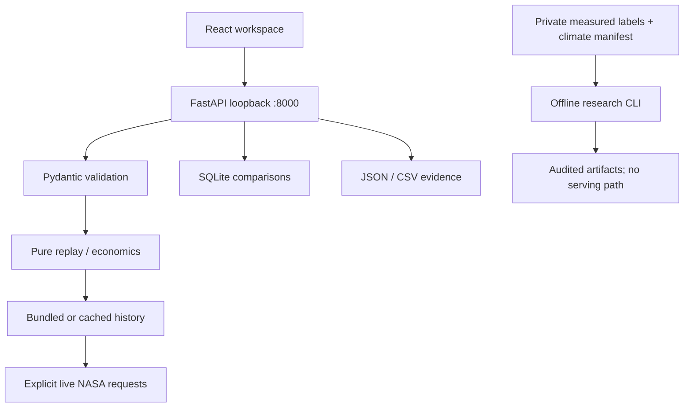

# Architecture and operations

`models.py` owns contracts, `climate.py` ingestion, `replay.py` pure computation,
`storage.py` SQL, `api.py` wiring and `training.py` offline crop-outcome research.
`satellite.py` audits HDF5 integrity; `forecast.py` trains and runs the separate
retrospective rainfall experiment. `GET /api/research/rainfall` returns its model
card; `POST /api/research/rainfall/predict` takes `{"issue_date":"2025-12-22"}`.
These endpoints use fixed bundled research artifacts and never update planning or
economic results. See [the research runbook](satellite-and-rainfall-research.md).
React does not
duplicate scientific calculations. Dependencies are locked in `uv.lock` and
`frontend/pnpm-lock.yaml`. CI uses bundled history and no NASA network call.

## API

| Route | Behavior |
| --- | --- |
| GET `/api/health` | Version and local-MVP state |
| GET `/api/config` | Defaults and rule metadata |
| POST `/api/compare` | Validated request → historical replay |
| POST `/api/economics` | Assumptions → scenario arithmetic |
| GET `/api/comparisons` | Latest 100 saved records |
| POST `/api/comparisons` | Server recomputes and stores a request |
| GET/DELETE `/api/comparisons/{uuid}` | Reopen/delete one saved record |
| GET `/api/comparisons/{uuid}/daily.csv` | Daily values, units, quality, hashes/version |
| GET `/openapi.json` | Current machine-readable schemas |

Validation errors: 422; absent records: 404; source failures: 503. SQL is parameterized,
IDs validated, CSV formulas protected, unknown/nonfinite requests rejected, and React
text escaped normally. Saved results cannot be supplied directly by a client.

No accounts/multitenancy: keep loopback-only. Trusted-host checks, origin restrictions
and security headers reduce browser attack surface but do not replace authentication.
The CSP permits inline styles for data-driven chart heights. It blocks Swagger's CDN
assets; use `/openapi.json` or a local API client rather than weakening the app policy.

## Configuration and storage

| Variable | Default/use |
| --- | --- |
| `TERRAPROOF_DATA_DIR` | Repository `data/`; relocates writable `local/` and `cache/` |
| `UV_CACHE_DIR` | Optional dependency cache relocation for restricted runners |
| `CI` | Browser tests use bundled Chromium when set, installed Chrome otherwise |

No secrets are required for NASA POWER. Never place future Earthdata/Azure credentials
in React or committed files. Public pilot coordinates are not private field records.

Stop the app before copying `data/local/terraproof.sqlite3`; retain the corresponding
Git commit/locks. Restore while stopped, then verify health and a saved comparison.
Version 0.1 has one comparisons table; future schema changes need migrations/restore
tests. Research runs, private records and caches are Git-ignored; public reference
data, templates and schemas are tracked.

Rollback native code to a reviewed commit, install frozen dependencies and rebuild.
For containers retain the previous image digest and data backup. Avoid
`docker compose down --volumes` unless intentionally deleting saved data.

## Later cloud sequence

1. Verify actual Space Apps eligibility, expiry, regions, services and quotas. No
   credit amount is assumed or offer activated.
2. Add Entra identity, record ownership and denial tests; configure exact hosted
   hosts/origins rather than replacing allowlists with wildcards.
3. Replace SQLite with reviewed shared persistence; private Blob Storage holds
   immutable source/model artifacts. Use managed identities and Key Vault.
4. Build/scan the container, deploy an internal staging Container Apps revision,
   and test authorization, source errors, migrations, backups, exports and cost limits.
5. Add Azure Monitor without exposing private coordinates. Run the same gated CLI
   as Azure ML jobs when real labels exist; registry success is not scientific approval.
6. Release after staging/field acceptance; rollback by image/revision while preserving
   data versions. No cloud deployment is performed in this local milestone.

The Dockerfile/compose file are local packaging scaffolding. The
[research roadmap](research-and-platforms.md) links Azure/NASA primary documentation
and explains when POWER, Earthdata, IMERG, SMAP, ECOSTRESS and Planetary Computer fit.
Optional sources are not claimed as integrated.

## Operational limits

- Live requests: 90-second HTTP timeout, at most three attempts; minutes are possible.
  Bundled mode remains usable without network. Cache keys include point/range/LST/version.
- No silent fallback to synthetic data or another source. Refresh/revisions are explicit.
- UI defaults to two plans; API supports two to four. This is not a rotation optimizer.
- Self-hosted fonts remove external asset requests during normal use.
- Native test success does not establish container/cloud/field validation; see QA report.
