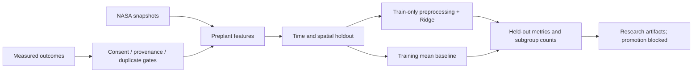

# Research training runbook

Stage A is the user-facing MVP. Stage B's offline code path is connected and tested,
but no measured field-season yield labels were supplied. There is no validated crop
model or prediction endpoint. Hazard flags and assumed yields are never used as
observed damage/yield labels.



## Connect real data

### HDF5 regression dependencies

Install the optional research tools from the repository root:

```bash
uv sync --frozen --extra training --python 3.12
# Or, inside your own virtual environment:
python -m pip install -r requirements-training.txt
```

`pyproject.toml` defines the requirements and `uv.lock` pins the resolved versions.
The training extra provides `h5py` to read HDF5 datasets, NumPy/SciPy for numerical
processing, and Matplotlib for residual and predicted-versus-observed plots. The
existing project dependencies provide pandas for feature/target tables, joblib for
model persistence, and scikit-learn for preprocessing, regression, and evaluation.
Scikit-learn includes LinearRegression, Ridge, RandomForestRegressor, and
HistGradientBoostingRegressor; Ridge and a mean baseline are implemented today.
The other estimators are available for future experiments.

HDF5 is a container, so select a named dataset rather than passing the entire file
to a regressor. For the NISAR SME2 sample, the main soil-moisture dataset is
`/science/LSAR/SME2/grids/soilMoisture`. Mask its `_FillValue`, inspect units and
quality flags, and align observations to field locations and acquisition dates
before deriving feature rows. Crop-yield regression still needs independently
measured yield targets; a satellite raster alone does not supply them. Keep shared
pixels, fields, and later dates out of training/test overlap, and compare held-out
MAE/RMSE against a mean baseline. Fit preprocessing only on training rows.

These dependencies prepare HDF5 experiments; the current `terraproof train` command
still takes the documented outcomes CSV and climate JSON manifest. HDF5 ingestion
is not connected to that command yet. Raw `.h5`/`.hdf5` files are ignored by Git.

To run the independent viewer in a separate environment:

```bash
uv venv .h5-viewer-runtime --python 3.12
uv pip install --python .h5-viewer-runtime/bin/python '.[viewer]'
.h5-viewer-runtime/bin/streamlit run h5_viewer.py
```

On Windows, use `.h5-viewer-runtime\Scripts\python.exe` and
`.h5-viewer-runtime\Scripts\streamlit.exe` in the last two commands.

### Existing training workflow

1. Follow [the data contract](data-contracts.md): actual consent, measured yield in
   t/ha, stable field IDs, crop/variety, source and verified season linkage.
2. Group farms and shared climate cells into conservative spatial blocks. Consider
   buffers for neighboring areas affected by the same climate events.
3. Acquire each group's climate history, covering at least 30 days before every
   planting. `terraproof.climate.fetch_power()` takes explicit coordinates/start/end;
   `save_snapshot()` archives its result. Review sources and rights before acquisition.
4. Map groups to snapshots using the manifest example in the data contract.
5. Pre-register later test years and completely held-out groups. Do not revise them
   after looking at test scores.
6. Choose a new output directory for every run:

```powershell
uv run terraproof train --outcomes data/local/observed-yields.csv --manifest data/local/climate-manifest.json --holdout-groups independent-region --test-from-year 2022 --output artifacts/research-001
```

The supplied empty template exits 2 and writes `readiness.json`. No synthetic dataset
is silently created. Existing experiment directories are never overwritten.

## Features and leakage controls

`preplant-v1`: 30-day preplant mean Tmax, preplant rainfall total, planting month,
field area. The 30-day window and Ridge alpha=1 are **engineering baseline choices**,
not studied agronomic cutoffs. The small feature set tests whether labels support
any meaningful baseline; it does not model every determinant of crop yield.

Feature windows end before planting; actual growing-season/post-harvest weather is
excluded by construction. Training harvest labels must precede the earliest test
planting date. Historical reanalysis is retrospective: revisions/publication latency
mean exact values may not have existed at the original decision time. Prospective
validation needs as-of snapshots and latency handling before operational claims.

Train: year < cutoff AND group outside holdouts. Test: year ≥ cutoff AND group inside
holdouts. Other rows are counted as unused. A field cannot span groups; train/test
cannot share declared climate grid IDs. Imputation/scaling fit only on training data
inside the pipeline, following [scikit-learn's leakage guidance](https://scikit-learn.org/stable/common_pitfalls.html).
There is no random row split, test-set tuning, or automatic model selection.

Execution floors: 10 training rows across at least two groups, five test rows. These
are **code sanity checks, not scientifically sufficient sample sizes**. Effective
sample size and independent units need a study design and qualified review.

## Outputs

| File | Evidence |
| --- | --- |
| `quality.json` | Accepted/excluded counts/reasons, hashes, feature version |
| `features.csv` | Preplant features, availability dates, label linkage, source/grid IDs |
| `predictions.csv` | Held-out observed/predicted/mean-baseline yields for diagnostics |
| `research-model.joblib` | Train-only preprocessing and Ridge; trusted local use only |
| `model-card.json` | MAE/RMSE t/ha, baseline MAE, counts, location/variety metrics, dependency versions, error spread, blocked promotion |
| `readiness.json` | Explicit gate failure reason |

Median/p90 absolute error is descriptive held-out spread, not calibrated prediction
intervals. Uncertainty calibration remains an explicit deployment gate. Joblib uses
pickle: never load untrusted artifacts. The API never loads or serves these models.

## Gates for later stages

Representative measured labels, independent spatial/temporal validation, subgroup
sample adequacy, missing-data/shift analysis, calibrated uncertainty, qualified
regional agronomic review and prospective decision testing remain required. Only
then consider nonlinear candidates or recommendations. Rotations, crop substitution
and price forecasts need their own targets and evidence.

Synthetic fixtures in `tests/test_training.py` verify joins, split behavior, leakage
rejections and artifacts only. Their metrics never appear as agricultural accuracy.

For Azure ML later, wrap this same CLI in a command job with versioned private data,
Git commit, locks, snapshot digests and split configuration. Keep registry promotion
separate from job success. See [the platform roadmap](research-and-platforms.md).

## Separate exploratory experiments

See [recorded research runs](research-runs/README.md) for additional PSA aggregate,
SME2 retrieval-surrogate and IRRI trial experiments. These scripts are separate from
`terraproof train`; they do not relax its consent, field linkage or independent
spatial/time holdout gates. They save results under ignored `artifacts/` directories
and are not loaded by the API. A favorable within-scene or within-station score does
not establish prospective Albay field performance. Raw downloads and model binaries
stay local; source metadata, download recipes and summarized reports are tracked.
